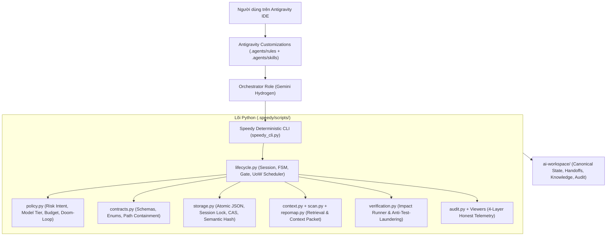

# Kiến Trúc Hệ Thống — Deterministic Harness Cho Antigravity IDE

> Tài liệu mô tả kiến trúc kỹ thuật của SNOW Builder và lõi Speedy DevKit v2.0 theo nguyên tắc **SOLID thực dụng, KISS, DRY và Zero-Dependency (Python 3.11+ stdlib)**.

---

## 1. Sơ Đồ Kiến Trúc Tổng Thể

---

## 2. Chiến Lược Điều Phối Model Gemini (Quota-Aware Routing)

Policy engine (`policy.py` & `config/policy.default.json`) phân bổ model theo độ phức tạp thực tế của từng bước:

1. **Gemini Hydrogen** *(Tier 1 — Nhẹ & Tiết kiệm)*: Giao cho `orchestrator`, `docs-manager`, `writer` và các bước tổng hợp, giúp giảm tải quota cho các lượt điều phối lặp lại.
2. **Gemini Neon** *(Tier 2 — Chủ lực mặc định)*: Giao cho `analyst`, `implementer`, `tester` và cả `architect`/`reviewer` đối với các task có độ phức tạp tiêu chuẩn.
3. **Gemini Carbon** *(Tier 3 — Giới hạn nghiêm ngặt)*: Chỉ được khuyến nghị cho `architect` hoặc `reviewer` độc lập khi `policy.py` phát hiện bài toán phức tạp cao hoặc chạm vùng nhạy cảm (`auth`, `payment`, `schema`, `security`), tránh lãng phí quota rất dễ chạm trần của Carbon.

---

## 3. Chiến Lược Tối Ưu Token & Tốc Độ (Không Đánh Đổi Correctness)

| Cơ chế | Cách hoạt động | Bảo toàn tính đúng đắn |
|---|---|---|
| **3-Tier Progressive Disclosure** | Chỉ giữ < 400 tokens ở rule `always_on`; toàn bộ skill/flow/role nạp theo nhu cầu qua `.agents/skills/`. | Giữ cố định các quy tắc bất biến (Invariants) ở Tier 0. |
| **Module-Level RepoMap** | Đánh chỉ mục cấp module kèm cache mtime, chỉ trả top-N kết quả phù hợp. | Tự làm mới khi cấu trúc thư mục đổi; không bịa module khi không khớp. |
| **Context Packet (`context prepare`)** | Cấp phát manifest con trỏ chứa đúng `AC`, `ADR` đã duyệt, phạm vi file và lỗi gần nhất. | Không bao giờ cắt bỏ `AC`, `invariants` hay bằng chứng lỗi cốt lõi. |
| **Selective Invalidation** | Gắn semantic checksum cho từng artifact và fingerprint cho evidence. | Sửa code chỉ làm invalid kết quả review/test cũ, giữ nguyên approval của Brief/ADR nếu thiết kế không đổi. |
| **Bounded Tool Output** | Giới hạn byte trả ra stdout kèm cờ `truncated` và đường dẫn log đầy đủ. | Agent vẫn đọc tiếp được đoạn log chi tiết trên đĩa khi cần chẩn đoán sâu. |
