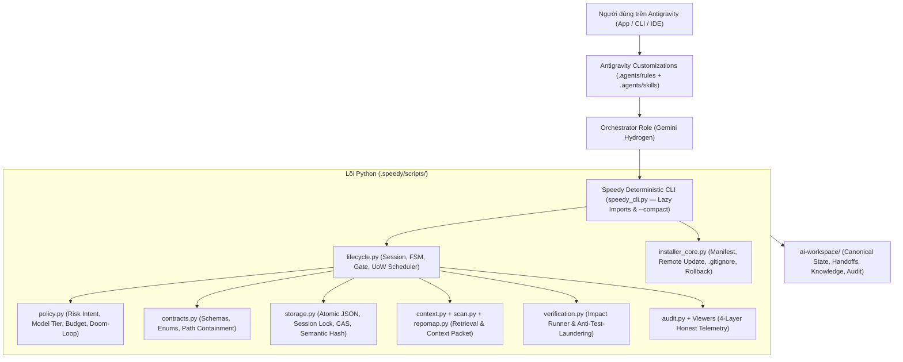
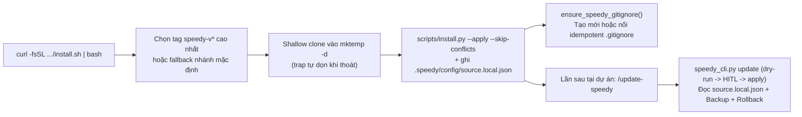

# Kiến Trúc Hệ Thống — Deterministic Harness Cho Antigravity IDE

> Tài liệu mô tả kiến trúc kỹ thuật của SNOW Builder và lõi Speedy DevKit v2.0 theo nguyên tắc **SOLID thực dụng, KISS, DRY và Zero-Dependency (Python 3.11+ stdlib)**.

---

## 1. Sơ Đồ Kiến Trúc Tổng Thể

---

## 2. Chiến Lược Điều Phối Model Gemini (Quota-Aware Routing)

Policy engine (`policy.py` & `config/policy.default.json`) phân bổ model theo độ phức tạp thực tế của từng bước:

1. **Gemini Hydrogen** *(Tier 1 — Nhẹ & Tiết kiệm)*: Giao cho `orchestrator`, `docs-manager`, `writer` và các bước tổng hợp, giúp giảm tải quota cho các lượt điều phối lặp lại.
2. **Gemini Neon** *(Tier 2 — Chủ lực mặc định)*: Giao cho `analyst`, `implementer`, `tester` và cả `architect`/`reviewer` đối với các task có độ phức tạp tiêu chuẩn.
3. **Gemini Carbon** *(Tier 3 — Giới hạn nghiêm ngặt)*: Chỉ được khuyến nghị cho `architect` hoặc `reviewer` độc lập khi `policy.py` phát hiện bài toán phức tạp cao hoặc chạm vùng nhạy cảm (`auth`, `payment`, `schema`, `security`), tránh lãng phí quota rất dễ chạm trần của Carbon.

---

## 3. Chiến Lược Tối Ưu Token & Tốc Độ (Không Đánh Đổi Correctness)

| Cơ chế | Cách hoạt động | Bảo toàn tính đúng đắn |
|---|---|---|
| **3-Tier Progressive Disclosure** | Chỉ giữ < 400 tokens ở rule `always_on`; toàn bộ skill/flow/role nạp theo nhu cầu qua `.agents/skills/`. | Giữ cố định các quy tắc bất biến (Invariants) ở Tier 0. |
| **Module-Level RepoMap** | Đánh chỉ mục cấp module kèm cache mtime, chỉ trả top-N kết quả phù hợp. | Tự làm mới khi cấu trúc thư mục đổi; không bịa module khi không khớp. |
| **Context Packet (`context prepare`)** | Cấp phát manifest con trỏ chứa đúng `AC`, `ADR` đã duyệt, phạm vi file và lỗi gần nhất. | Không bao giờ cắt bỏ `AC`, `invariants` hay bằng chứng lỗi cốt lõi. |
| **Selective Invalidation** | Gắn semantic checksum cho từng artifact và fingerprint cho evidence. | Sửa code chỉ làm invalid kết quả review/test cũ, giữ nguyên approval của Brief/ADR nếu thiết kế không đổi. |
| **Bounded Tool Output & Compact CLI** | Giới hạn byte trả ra stdout kèm cờ `truncated`; `speedy_cli.py` dùng **Lazy Imports** (~55ms cold-start), lệnh gộp **`state complete`** (1 lệnh/stage) và cờ **`--compact`** (-25–30% token JSON). | Agent vẫn đọc tiếp được log chi tiết trên đĩa; giảm mạnh độ trễ và token tích lũy mà không bỏ qua bất kỳ kiểm định nào. |

---

## 4. Hệ Thống Slash Commands Thống Nhất (`.agents/skills/` — Không Duplicate)

- Toàn bộ slash commands được khai báo duy nhất một nơi tại `.agents/skills/<name>/SKILL.md` (frontmatter YAML single-line chuẩn Antigravity), **không** tạo song song legacy `.agents/workflows/` để tránh hiện trùng lặp lệnh trong menu `/`.
- **Speedy DevKit (11 lệnh ngắn gọn)**: `/flow`, `/specs`, `/analyst`, `/docs`, `/docs-view`, `/audit-view`, `/refresh-rule`, `/refresh-style`, `/cleanup`, `/repomap`, `/update-speedy`.
- **SNOW Builder (10 lệnh quản trị)**: `/builder-flow`, `/builder-analyst`, `/builder-architect`, `/builder-implementer`, `/builder-reviewer`, `/builder-qa`, `/builder-autotest`, `/builder-docs-manager`, `/builder-writer`, `/builder-release`.

---

## 5. Kiến Trúc Phân Phối 1 Lệnh, Auto `.gitignore` & Zero-Config `/update-speedy`

- **Thứ tự phân giải nguồn cập nhật** (tuyệt đối không dùng `git remote origin` của dự án đích):
  1. Tham số `--source`
  2. Biến môi trường `SPEEDY_SOURCE_URL`
  3. Khóa `SPEEDY_SOURCE_URL` trong `ai-workspace/.env`
  4. File cấu hình local `.speedy/config/source.local.json` *(nằm ngoài `manifest.json` để không gây xung đột và không rò rỉ URL Builder vào `src/`)*
  5. `.speedy/config/source.json`
- **Ignore 2 lớp an toàn cho Git & Antigravity**: `ensure_speedy_gitignore()` ghi `/.speedy/` và `/ai-workspace/` vào `.gitignore`, đồng thời ghi `/.agents/` và `/AGENTS.md` vào `.git/info/exclude` (khi dự án là Git repo) để Git không push nhầm nhưng Antigravity vẫn quét đầy đủ slash commands.
- **Bảo mật & Toàn vẹn**: Mọi lệnh `git ls-remote` / `git clone` đều chặn tham số bắt đầu bằng `-` và sử dụng dấu phân tách `--` để ngăn argument injection; rollback khôi phục nguyên trạng cả file kit-owned, `.gitignore`, `.git/info/exclude` và `source.local.json`.
