# Tổng Quan Hệ Thống — SNOW Builder & Speedy DevKit (Antigravity IDE)

> **TL;DR**: **SNOW Builder** là xưởng chế tạo và kiểm định bộ công cụ **Speedy DevKit** (`src/`) dành riêng cho **Antigravity IDE**. Khi cài vào dự án của người dùng, Speedy kết hợp hệ thống chỉ dẫn phân tầng (Progressive Disclosure), định tuyến model thông minh (**Gemini Hydrogen / Neon / Carbon**) và lõi **CLI Deterministic** để giúp AI lập trình chính xác, nhanh và tiết kiệm tối đa token/quota.

---

## 1. Bài Toán Cần Giải Quyết

| Vấn đề thường gặp khi code với AI | Cách tiếp cận của Speedy DevKit v2.0 |
|---|---|
| Hội thoại kéo dài làm AI quên yêu cầu hoặc tự mở rộng phạm vi | Chuyển giao qua **Handoff Contract** + **Canonical JSON State** trên đĩa |
| Agent báo "đã hoàn thành" nhưng code lỗi hoặc sửa test cho qua | **Verification Gate** thực thi lệnh thật + bộ dò **Test Laundering** |
| Đọc toàn bộ mã nguồn gây tốn token và cạn nhanh quota model mạnh | **3-Tier Progressive Disclosure** + phân bổ **Hydrogen / Neon / Carbon** đúng việc |
| Khó tiếp tục công việc ở phiên chat mới hoặc sau khi gián đoạn | Cơ chế **Resume có kiểm chứng** theo `sid`, semantic checksum và snapshot code |
| Công cụ AI trộn lẫn tài liệu nội bộ với tài liệu của dự án ứng dụng | Tách biệt hoàn toàn tại `.speedy/` + `ai-workspace/` kèm **Ownership Manifest** & Rollback |

---

## 2. Phân Tách Hai Không Gian Làm Việc

```mermaid
flowchart LR
    subgraph Builder["SNOW Builder (Root Repo)"]
        BR["AGENTS.md + rules/ + .agents/ (Rules, Skills, Workflows)"]
        BS["scripts/ (install.sh, install.py, package.py, autotest.py)"]
        BT["tests/ (Static + CLI + Installer + E2E Fixture)"]
        BP["plans/ + sessions/"]
    end

    subgraph Product["Speedy DevKit (src/ — Xuất độc lập)"]
        PA["AGENTS.md + .agents/ (Rules, Skills & Workflows)"]
        PE[".speedy/ (roles, flows, commands, schemas, scripts)"]
        PW["ai-workspace/ (docs, specs, sessions, state, audit)"]
    end

    Builder -->|"Xây dựng, kiểm thử & đóng gói"| Product
    Product -->|"1 lệnh curl | bash / install.py + /update-speedy"| UserApp["Dự án Ứng dụng trên Antigravity (App / CLI / IDE)"]
```

- **Ranh giới một chiều**: Builder được phép gọi kiểm thử và đóng gói `src/`, nhưng **không một file nào trong `src/`** được phép import hay trỏ đường dẫn ngược về Builder (URL nguồn Git được lưu runtime tại `.speedy/config/source.local.json` của dự án đích, nằm ngoài `manifest.json`).
- **Tương thích Dual-Surface**: Hỗ trợ song song `.agents/skills/` (Antigravity App 2.0 / CLI) và thin wrappers `.agents/workflows/` (Antigravity IDE standalone) để mọi slash command ngắn gọn (`/flow`, `/specs`, `/docs`, `/update-speedy`,...) hoạt động nhất quán trên mọi bề mặt.
- Xem chi tiết thiết kế kỹ thuật tại [ARCHITECTURE.md](ARCHITECTURE.md), hướng dẫn cài đặt & cấu hình tại [ANTIGRAVITY_GUIDE.md](ANTIGRAVITY_GUIDE.md) và bản đồ thành phần sản phẩm tại [product/README.md](product/README.md).
